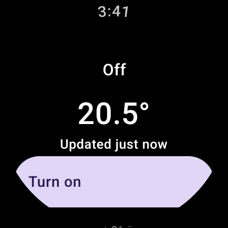
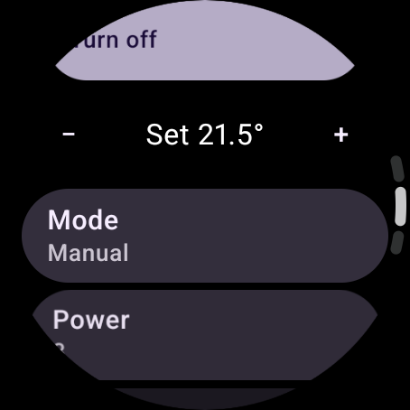
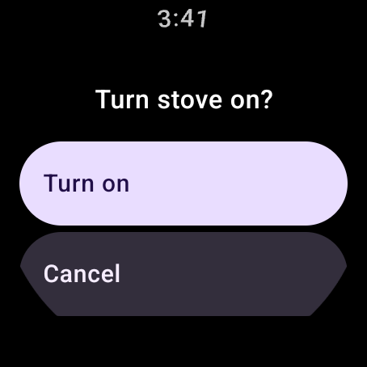
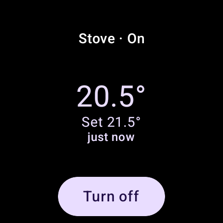

# MCZ WearOS

[](https://github.com/nosari20/MCZ-WearOS/actions/workflows/ci.yml)
[](LICENSE)

**Stove Remote** is a standalone **Wear OS** app and **Tile** that control an **MCZ Maestro** pellet stove directly
over **Bluetooth Low Energy**. No phone, no MCZ cloud, no account.

| Main | Controls | Confirm | Tile |
|---|---|---|---|
|  |  |  |  |

> [!WARNING]
> This is an **unofficial** project, not affiliated with or endorsed by MCZ Group. It talks to
> a heating appliance using a reverse-engineered protocol. Use it at your own risk and never
> leave a stove running unattended because of what an app shows. See [Safety](#safety).

## Features

- Room temperature, setpoint, stove state (Off, Cleaning, Loading, Start, Stabilization,
  On, Turning off) and active alarm.
- Turn the stove on/off (always behind a confirmation screen).
- Change setpoint (0.5 °C steps), mode (Manual / Auto / Overnight / Comfort / Turbo),
  power level 1–5 and fan level 1–5 / Auto.
- Tile with room temperature, setpoint and state, refreshed when you swipe to it, plus an
  on/off shortcut.
- Releases the Bluetooth link after 30 s of inactivity so the official app can still connect.

## Requirements

- Watch running **Wear OS 4 or newer** (API 33+), e.g. Pixel Watch, Galaxy Watch 4+.
- MCZ stove with the **Maestro** module (advertises over BLE as `MCZ_EP…`).
- To build: Android Studio (or JDK 17+) and the Android SDK (compileSdk 37).

## Build and install

```bash
./gradlew :app:testDebugUnitTest :app:assembleRelease
```

Use the **release** build on a watch: debug builds of Compose for Wear OS scroll noticeably
worse. The release APK is signed with your local debug key, which is fine for sideloading.

Install on the watch with wireless debugging (watch: *Settings → Developer options →
Wireless debugging*):

```bash
adb pair <watch-ip>:<pairing-port> <pairing-code>
adb connect <watch-ip>:<debug-port>
adb -s <watch-ip>:<debug-port> install -r app/build/outputs/apk/release/app-release.apk
```

## First pairing

1. On the stove panel, press **+** and **−** together until the Bluetooth icon blinks
   (or power-cycle the stove: it boots in pairing mode).
2. Open the app on the watch, grant the Bluetooth permission and pick the `MCZ_EP…` stove.
3. Accept the system pairing prompt if one appears.

The stove refuses connections from devices it is not paired with, and accepts a new pairing
only while the Bluetooth icon blinks. If pairing fails, put the panel back in pairing mode and
pick the stove again.

The stove module most likely accepts a single Bluetooth client at a time: close the official
app while using the watch. The watch releases the link after 30 s without activity.

Debug builds also offer a **Demo stove** on the pairing screen: a simulated stove used to try
the UI on an emulator, which has no Bluetooth.

## How it works

The Maestro module exposes GATT service `0xABF0`. Requests are written to `0xABF1`, replies
and status broadcasts are notified on `0xABF2`. Each frame is AES-128-CBC encrypted:

```
[counter u32 LE][16-byte token][Modbus RTU PDU][CRC16][PKCS#7 padding]
```

Inside is plain Modbus RTU (slave `0x01`, function `0x03` read / `0x06` write). The register
map lives in [`Registers.kt`](app/src/main/kotlin/com/mczadvanced/wear/protocol/Registers.kt).
The power register is a **toggle**, so the app re-reads the stove phase immediately before
writing it and never retries that write.

Code layout:

| Package | Role |
|---|---|
| `protocol` | Pure Kotlin: CRC, Modbus PDUs, AES frame codec, broadcast reassembly, register → state mapping. Fully unit-tested. |
| `data` | `StoveRepository` (single source of truth, sessions, idle disconnect, command safety), DataStore cache, demo stove. |
| `ble` | Android GATT transport and scanner. |
| `ui` | Compose for Wear OS screens. |
| `tile` | ProtoLayout Material 3 tile. |

The design document is in [`docs/design.md`](docs/design.md). Google Play publishing
steps and store listing assets: [`docs/google-play.md`](docs/google-play.md).
Privacy policy: [`PRIVACY.md`](PRIVACY.md).

## Safety

- Commands are only sent when you confirm them; the app never turns the stove on by itself.
- The on/off command is a toggle on the stove side. The app reads the current phase in the
  same Bluetooth session right before sending it and sends it at most once.
- Displayed values can be stale (the age is always shown). Always check the stove itself.
- Follow your stove's manual and local regulations. The authors accept no liability.

## Credits

Protocol knowledge (frame format, keys, register map) comes from the reverse-engineering
work in [Houtmann/mcz-maestro-ble](https://github.com/Houtmann/mcz-maestro-ble) and its
upstream. No code was copied; the protocol is reimplemented in Kotlin.

MCZ and Maestro are trademarks of their respective owners.

## Contributing

Contributions are welcome. See [CONTRIBUTING.md](CONTRIBUTING.md) and the
[Code of Conduct](CODE_OF_CONDUCT.md). Report security issues as described in
[SECURITY.md](SECURITY.md).

## License

[Apache License 2.0](LICENSE) — see also [NOTICE](NOTICE). Changes are listed in [CHANGELOG.md](CHANGELOG.md).
